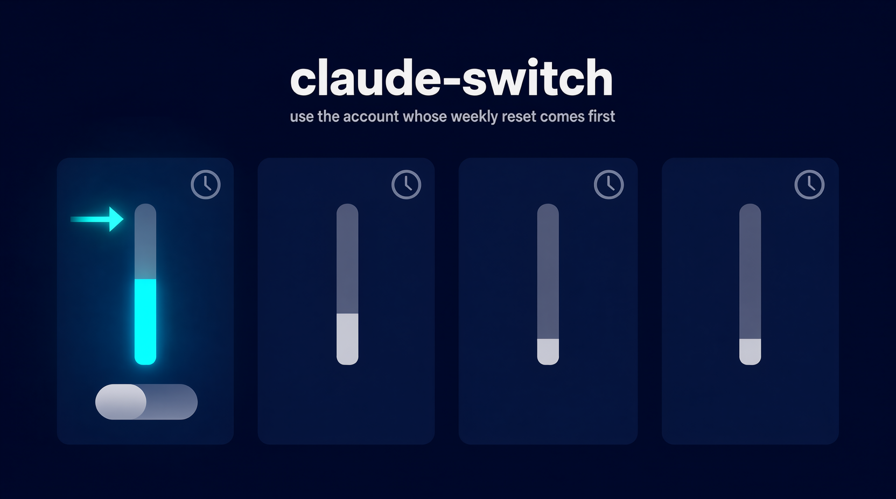
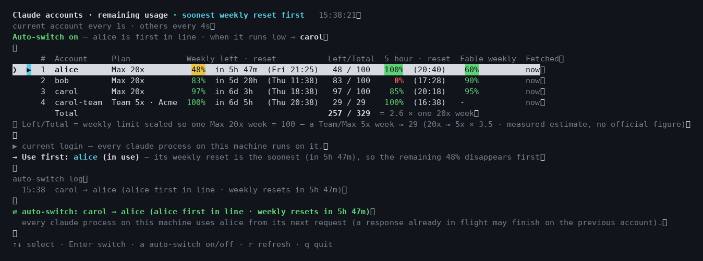

<p align="center"></p>

# claude-switch (`cs`)

**Several Claude subscriptions, one machine, one `claude` login.** `cs` shows how much of every
account's 5-hour and weekly limits is left, sorts them by the weekly reset that comes first, and swaps
the login that Claude Code (and every agent built on it) uses — by hand or automatically.

```
Claude accounts · remaining usage · soonest weekly reset first   15:13:05
current account every 1m · others every 5m
Auto-switch on — alice is first in line · when it runs low (≤1% left, or draining fast enough to hit 0 before the next check) → bob

       #  Account     Plan          Weekly left · reset              Left/Total  5-hour · reset   Fable weekly  Fetched
  ❯ ▶  1  alice       Max 20x        48%  in 5h 47m   (Fri 21:00)     48 / 100   100%  (20:15)     60%          now
       2  bob         Max 20x        83%  in 5d 20h   (Wed 11:00)     83 / 100     0%  (17:03)     90%          4s ago
       3  carol       Max 20x        97%  in 6d 3h    (Wed 18:00)     97 / 100    85%  (19:53)     95%          4s ago
       4  carol-team  Team 5x · Acme 100%  in 6d 5h    (Wed 20:00)     29 / 29    100%  (16:13)                  4s ago
          Total                                                      257 / 329
```

Why the ordering matters: whatever is left of an account's weekly limit **disappears at its weekly
reset**. If you spread work evenly, you throw quota away every week. Using the account whose reset
comes first keeps the most usable quota alive across all accounts.

<p align="center"></p>

## What it does

- **One table for all accounts** — 5-hour window, weekly window, per-model weekly window (e.g. Fable),
  time until each reset, extra-usage warnings, team seats, and a `Left/Total` column that puts
  Max 20x and Team/Max 5x seats on one scale so the numbers can be added up.
- **Live screen** — keeps refreshing (current account every minute, idle ones every 5 minutes), honours
  the usage API's own rate limit the way the Claude CLI does, rings a bell when the current account hits
  a limit, and moves the cursor to the next usable account. `↑↓` pick, `Enter` switch, `a` auto-switch,
  `r` refresh, `q` quit.
- **Auto-switch** (`a` or `cs auto on`) — while a screen is open it
  1. keeps the **first-in-line account** in use: as soon as an account that sorts above the current one
     (its weekly reset comes sooner) has quota again, it moves there; and
  2. leaves a **draining** account just before it runs dry (≤1 % left, or the recent burn rate says it
     will hit 0 before the next check) for the next account in line.

  It never moves onto an account with extra usage enabled (that one bills instead of blocking) or onto
  one with ≤5 % left. Every move is logged to `~/.claude-accounts/auto-switch.log`.
- **Safe switching** — the login file is swapped under the same locks the Claude CLI uses, the outgoing
  login is backed up first, the token of the account in use is never refreshed (refresh tokens are
  single-use), and nothing is written when the current login cannot be identified.
- **`cs add`** replaces `/login`: it stores the current login before starting a new one, so no account
  is lost. Same email in a personal plan and a team? Add it twice and pick the organization in the
  browser — the seat is stored separately as `name-team`.
- **`cs keep`** runs the screen inside a tmux session so a closed window or a dropped SSH session does not
  stop auto-switching.

## Install

Python 3.9+ and the [Claude Code](https://docs.anthropic.com/en/docs/claude-code) CLI (`claude`) are
the only requirements. No third-party packages.

```sh
git clone https://github.com/ruucm/claude-switch.git
ln -s "$PWD/claude-switch/cs.py" ~/.local/bin/cs   # or anywhere on your PATH
cs help
```

Linux and macOS (it uses `fcntl`, `termios` and `pty`). On Windows run it inside WSL.

## Usage

```
cs                live screen (outside a terminal: prints the table once)
cs ls             print the table once
cs 2 · cs joe     switch to that account (numbers follow the table order; names are stable)
cs add [email]    log a new account in and store it
cs auto [on|off]  show / enable / disable auto-switch
cs keep           live screen inside tmux session "cs" (run again to re-attach)
cs help
```

First run: `cs` stores the login you already have. Then `cs add` for each additional account.
From another machine: `ssh -t host '~/.local/bin/cs'`.

### Reading the table

| Column | Meaning |
|---|---|
| `▶` | the login in use right now |
| `Weekly left · reset` | % of the weekly limit left, time until it resets, and the weekday/time |
| `Left/Total` | the weekly limit on a shared scale: one Max 20x week = 100, a 5x seat ≈ 29 (see below) |
| `5-hour · reset` | % of the 5-hour window left and when it resets |
| `<model> weekly` | a per-model weekly limit when the API reports one (e.g. Fable) |
| `Fetched` | how old the row's numbers are (live screen only) |
| `→ Use first` | the top usable account — the one whose remaining weekly quota disappears first |

The usage API only returns percentages. Anthropic publishes multipliers for the 5-hour window only
(Max 20x = 4 × Max 5x). The weekly multiplier defaults to **3.5**, a community measurement
([Classmethod, 2026-08](https://dev.classmethod.jp/)) that matched `/usage` percentages against
locally logged token usage; override it with `CS_WEEK_RATIO`.

### Auto-switch rules

| Situation | What happens |
|---|---|
| An account above the current one in the table has > `CS_AUTO_MIN` (5 %) left in both windows | move there — its weekly quota would otherwise be lost first |
| The current account has ≤ `CS_AUTO_FLOOR` (1 %) left in either window | move to the first account in line with > 5 % left |
| The current account is draining fast enough to hit 0 before the next check | same, one check early |
| Nowhere to go | stay, ring once, move as soon as an account frees up |
| Several `cs` screens open | only the one holding `auto.lock` switches; another takes over when it quits |

Switching is cheap: the CLI re-reads its credentials file whenever the file's mtime changes, so a swap
takes effect on the next request without restarting anything. A response already in flight finishes on
the account it started with.

### Configuration

| Variable | Default | |
|---|---|---|
| `CS_INTERVAL` | `60` | seconds between fetches for the current account |
| `CS_IDLE_INTERVAL` | `300` | seconds between fetches for idle accounts |
| `CS_LIMIT_BACKOFF` | `300` | first back-off after a 429/403 from the usage API (doubles, max 1 h) |
| `CS_AUTO_FLOOR` | `1` | % left at which a draining account is abandoned |
| `CS_AUTO_MIN` | `5` | minimum % left (both windows) for an account to be moved onto |
| `CS_AUTO_COOLDOWN` | `30` | seconds before auto-switch is evaluated again after a move |
| `CS_WEEK_RATIO` | `3.5` | one Max 20x week ÷ one Max/Team 5x week |
| `CS_VAULT_DIR` | `~/.claude-accounts` | where logins, backups, settings and the log live |
| `CS_CLAUDE_BIN` | `claude` on PATH | the CLI used by `cs add` |

Times are shown in the machine's local time zone (`TZ`).

## How it works

Verified against the Claude CLI binary (2.1.310):

- Every `claude` on a machine runs on `~/.claude/.credentials.json`; the account shown in the UI comes
  from `oauthAccount` in `~/.claude.json`. `cs` keeps a copy of each login in `~/.claude-accounts/accounts/`
  (directory `700`, files `600`) and swaps the two files.
- Before each API call the CLI compares the credentials file's mtime and re-reads it when it changed —
  that is why a swap moves running agents without a restart.
- Token refresh takes `~/.claude/.oauth_refresh.lock` and `~/.claude.lock`; config saves take
  `~/.claude.json.lock` (proper-lockfile directory locks). `cs` takes the same locks in the same order and
  removes stale ones the same way.
- Refresh tokens rotate: a refresh token is dead after one use. `cs` therefore never refreshes the login
  in use (the CLI will), refreshes idle accounts only when their access token is about to expire, and
  writes the rotated token to the vault immediately.
- Usage comes from `GET /api/oauth/usage` (what `/usage` shows), identity from `GET /api/oauth/profile`.
  Both are rate limited; `cs` backs off like the CLI (Retry-After, else 5 min doubling up to 1 h).
- A login token is bound to one organization. The same email can hold a personal plan and a team seat;
  the browser login asks which one. While a team seat is in use, that team's managed settings apply.

### Safety rules (enforced in code)

1. The token of the account in use is never refreshed by `cs`.
2. Nothing is refreshed or switched when the current login cannot be identified (vault token match or profile API).
3. The current login is stored on every run; the outgoing login is backed up before every switch (last 30 kept).
4. An unverified identity never overwrites a vault entry that holds a different token.
5. Same email, different organization = different account; a team login never overwrites the personal entry.
6. Auto-switch re-fetches every account right before acting and does nothing if the picture changed meanwhile.

Do not use `/logout` inside `claude` — it can invalidate the stored login of that account. Use `cs add` instead of `/login`.

## Caveats

- `~/.claude-accounts` contains login tokens. Keep it on this machine; do not copy or commit it.
- Idle refresh tokens expire after roughly four weeks of disuse. Running `cs` now and then keeps them alive.
- Anthropic's consumer terms do not address multiple subscriptions explicitly; rotating accounts to
  work around limits is a grey area. You decide whether that is acceptable for your situation.
- This relies on undocumented CLI behaviour (file paths, lock names, endpoints). A CLI update can break it.

## Tests

```sh
python3 -I test_cs.py   # ~2 minutes
```

33 scenarios / 163 checks against a fake `HOME` and a fake API server (token rotation, single-use refresh
tokens, User-Agent check, per-account reset times, rate limiting, team seats). The live screen is driven
on a real pty; auto-switch scenarios ramp usage over time to exercise the burn-rate rule; `cs keep` uses a
private tmux server. Real logins are never touched. `tools/demo_screenshot.py` renders `assets/screenshot.png`
from the same fake server.

## License

MIT
